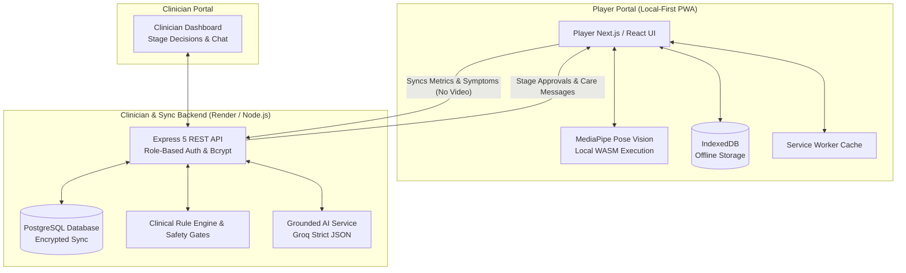

# ComeBack

> **AI-Powered Post-Pregnancy Recovery & Rehabilitation Platform for Female Athletes**  
> *A clinician-connected, privacy-preserving, local-first companion turning clinical return-to-play guidelines into actionable, measurable daily journeys.*

[](https://github.com/nourinzaman2005-droid/comeback/actions/workflows/ci.yml)
[](https://www.typescriptlang.org/)
[](https://nextjs.org/)
[](https://react.dev/)
[](https://tailwindcss.com/)
[](https://vitest.dev/)
[](https://playwright.dev/)

---

## Overview

In women’s cricket and elite female sports, motherhood has historically meant either career interruption or premature retirement. Static sports medicine guidelines (such as the ICC Return to Play Post-Pregnancy Guidelines) are often distributed as 40+ page clinical PDFs. Female athletes returning postpartum face pelvic floor vulnerability, joint laxity, and musculoskeletal strain without structured, daily, on-the-ground support.

**ComeBack** bridges this critical gap. It is a dual-role, local-first digital companion connecting returning players with certified sports clinicians. It translates evidence-based clinical protocols into structured daily check-ins, on-device computer vision movement assessments, grounded AI explanations, and strict clinician-gated stage progressions.

---

## Key Features

- **Evidence-Based "6 Rs" Recovery Pathway**: Grounded in official postpartum guidelines across 6 distinct stages:
  1. *Respect* (Early rest & pelvic floor healing)
  2. *Recover* (Low-impact conditioning & core reconnection)
  3. *Reload* (Gradual strength & load tolerance)
  4. *Recondition* (Cricket-specific functional movement)
  5. *Return* (Gradual match simulation)
  6. *Realise* (Full competitive return)
- **Private On-Device Computer Vision**: Runs real-time MediaPipe Vision pose landmarking directly in the athlete's browser (WebAssembly). Evaluates squats, single-leg balances, and hops for knee flexion, symmetry, stability, and rep counting. **Zero video or images are ever uploaded to any server or cloud**—only computed biomechanical metrics are logged.
- **Strict Dual-Role Governance**: Strictly separated portals for **Players** (`/`) and **Clinicians** (`/clinician`). Players cannot self-clear or skip stages; every stage progression requires explicit review and approval from a verified clinician.
- **Automated Clinical Safety Locks**: If a player reports any red-flag symptom (pelvic pain, heaviness, urinary leakage, bleeding, or joint instability), stage progression is automatically locked until a clinician evaluates the case.
- **Grounded AI with Clinical Guardrails**: An AI explanation assistant powered by Groq (`openai/gpt-oss-20b`) with strict JSON schema outputs. It answers questions using only cited clinical guidelines and strictly refuses clearance or diagnostic requests. A deterministic fallback operates if API keys or connectivity are unavailable.
- **Multilingual & Bidirectional Layouts**: Full native support for **English**, **Bengali (বাংলা)**, **Hindi (हिन्दी)**, and **Urdu (اردو)** with dynamic right-to-left (RTL) page layout adaptation.
- **Offline-First Resilience**: Engineered as a Progressive Web App (PWA) with Service Worker runtime caching and IndexedDB local storage. Athletes can perform check-ins in low-connectivity training grounds; data syncs when back online.

---

## System Architecture



---

## Tech Stack

| Layer | Technologies |
|---|---|
| **Frontend Framework** | [Next.js 16](https://nextjs.org/) (App Router), [React 19](https://react.dev/), [TypeScript 6](https://www.typescriptlang.org/) |
| **Styling & Icons** | [Tailwind CSS v4](https://tailwindcss.com/), [Lucide React](https://lucide.dev/) |
| **Computer Vision** | [@mediapipe/tasks-vision](https://www.npmjs.com/package/@mediapipe/tasks-vision) (BlazePose WASM, client-side) |
| **Backend API** | [Node.js](https://nodejs.org/), [Express 5](https://expressjs.com/), [Helmet](https://helmetjs.github.io/), [CORS](https://www.npmjs.com/package/cors) |
| **Database & Auth** | [PostgreSQL](https://www.postgresql.org/) (`pg`), [BcryptJS](https://www.npmjs.com/package/bcryptjs), Secure HTTP-only cookies |
| **Grounded AI** | [Groq Cloud API](https://groq.com/) with strict JSON structured outputs and deterministic fallback |
| **Testing & Quality** | [Vitest](https://vitest.dev/) (100% statement/branch coverage), [Playwright](https://playwright.dev/) (Multi-device E2E), [@axe-core/playwright](https://www.npmjs.com/package/@axe-core/playwright) (Accessibility) |
| **Video Production** | [Remotion](https://www.remotion.dev/) (Automated programmatic promo video pipeline) |

---

## Project Materials & Documentation

- 📊 **Pitch Deck**: [`docs/submission/ComeBack Pitch Deck.pdf`](docs/submission/ComeBack%20Pitch%20Deck.pdf) — Complete 17-slide pitch deck (Story arc, problem validation, product walkthrough, competitive moat, business model).
- 🎙️ **Presentation Script**: [`docs/submission/PRESENTATION_SCRIPT.md`](docs/submission/PRESENTATION_SCRIPT.md) — 3-minute pitch script and comprehensive jury Q&A preparation.
- 🎬 **Video Scripts**:
  - Promo Video Script: [`docs/submission/PROMO_VIDEO_SCRIPT.md`](docs/submission/PROMO_VIDEO_SCRIPT.md)
  - Product Demo Script: [`docs/submission/DEMO_VIDEO_SCRIPT.md`](docs/submission/DEMO_VIDEO_SCRIPT.md)
- 📐 **Technical & Architecture Specifications**:
  - Camera & Movement Validation: [`docs/CAMERA_VALIDATION.md`](docs/CAMERA_VALIDATION.md)
  - Role Segregation & Clinical Journeys: [`docs/TIER_3_4.md`](docs/TIER_3_4.md)
  - Grounded AI & Localization Guardrails: [`docs/TIER_5_6.md`](docs/TIER_5_6.md)
  - Production Deployment Guide: [`docs/RENDER_SETUP.md`](docs/RENDER_SETUP.md)
  - Contributor Roles: [`docs/TEAM_TASKS.md`](docs/TEAM_TASKS.md)

---

## Quickstart & Local Development

### Prerequisites

- Node.js 22+ (tested on Node v24)
- npm 10+

### Installation

```bash
git clone https://github.com/nourinzaman2005-droid/comeback.git
cd comeback
npm install
```

### Start Development Server

```bash
npm run dev
```

This starts both the Next.js frontend (`http://localhost:3000`) and the local Express mock API (`http://localhost:10000`) concurrently.

### Demo Credentials

For quick evaluation without setting up an external database:

| Role | Portal URL | Email | Password |
|---|---|---|---|
| **Player** | `http://localhost:3000` | `nourin@comeback.demo` | `ComeBack2026!` |
| **Clinician** | `http://localhost:3000/clinician` | `maya.rahman@icc-demo.org` | `CareTeam2026!` |

> **Note:** The player and clinician portals are strictly isolated. A player session cannot access clinician tools, and a clinician cannot simulate player check-ins.

---

## Verification & Testing

The codebase maintains rigorous quality standards with 100% test coverage on core progression rules and extensive E2E suites:

```bash
# Run unit & integration tests
npm test

# Run tests with full v8 coverage report
npm run test:coverage

# Run Playwright E2E tests (mobile and desktop viewports)
npm run test:e2e

# Run linter
npm run lint

# Validate file sizes
npm run check:files

# Build production bundle
npm run build
```

---

## Medical & Privacy Disclaimer

- **Not a Medical Device**: ComeBack is an assistive companion platform designed to support clinical workflows. It does not provide medical diagnoses, treatment plans, or unverified clearance.
- **Clinical Oversight**: Progression between recovery stages requires explicit review and approval by an authorized clinician.
- **Privacy First**: High-resolution video feeds from device cameras are processed entirely in browser memory using WebAssembly. Video frames are never recorded, transmitted, or stored on external servers.

---

## Team & Credits

- **Nourin Zaman Richi** ([@nourinzaman2005-droid](https://github.com/nourinzaman2005-droid)): Product architecture, player mobile experience, computer vision pipeline, accessibility, and presentation narrative.
- **Ashra Rahman Tuba** ([@ashrarahman](https://github.com/ashrarahman)): Clinical guideline modeling, deterministic rules engine, backend security, clinician portal, and database synchronization.
